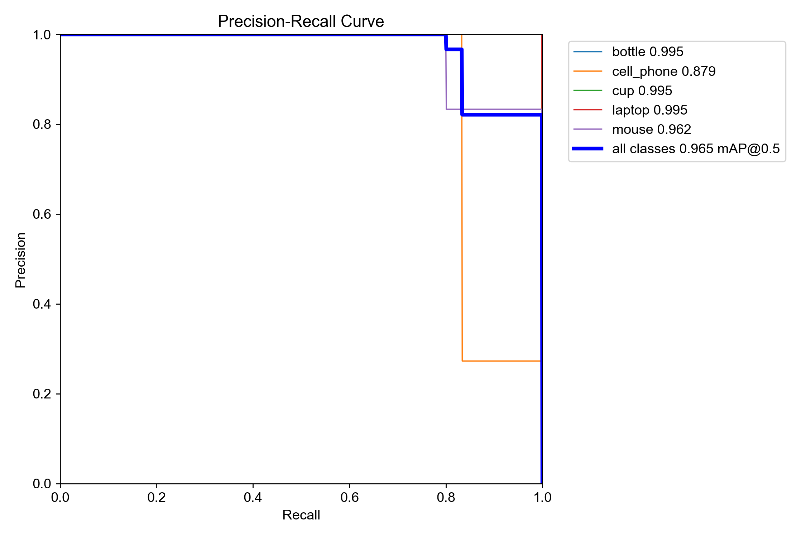
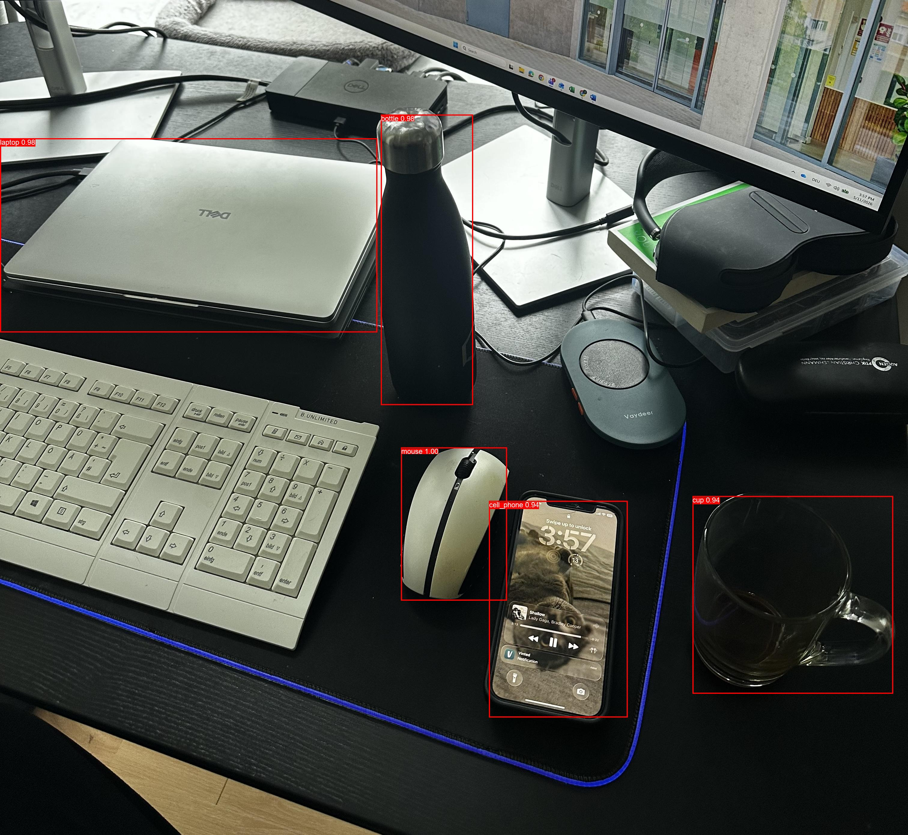
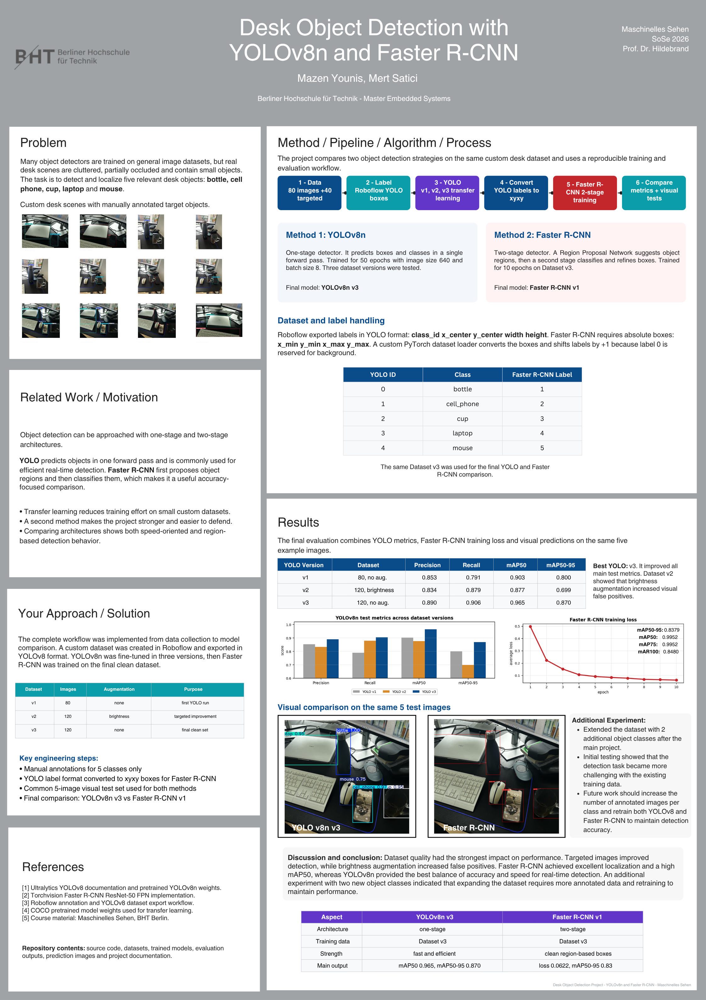

# Desk Object Detection with YOLOv8n and Faster R-CNN

**Master's Course Project – Machine Vision (Maschinelles Sehen)**  
**M.Eng. Computer Engineering – Embedded Systems · BHT Berlin · 2026**  
**Mazen Younis · Mert Satici**

## Overview

This project implements and compares two object-detection approaches for cluttered real-world desk environments:

- **YOLOv8n** – a one-stage object detector designed for efficient inference
- **Faster R-CNN** – a two-stage region-based detector using a Region Proposal Network

A custom dataset of real desk scenes was created and manually annotated for five target classes:

- `bottle`
- `cell_phone`
- `cup`
- `laptop`
- `mouse`

The project covers the complete workflow from image collection and annotation to transfer learning, dataset refinement, model evaluation and architectural comparison.

## Project Pipeline

1. Collect and manually annotate desk images
2. Train multiple YOLOv8n versions using transfer learning
3. Analyse weaknesses and extend the dataset with targeted images
4. Convert YOLO-format annotations for Faster R-CNN
5. Train Faster R-CNN on the final dataset
6. Evaluate both approaches quantitatively
7. Compare visual predictions on the same task

## Dataset

The initial dataset contained **80 source images**. After the first training experiments, **40 additional targeted images** were collected, particularly to improve more difficult classes such as `cell_phone` and `mouse`.

The final dataset contained **120 source images**.

| Dataset | Source Images | Augmentation | Purpose |
|---|---:|---|---|
| v1 | 80 | None | Initial YOLO fine-tuning |
| v2 | 120 | Brightness | Targeted improvement |
| v3 | 120 | None | Final clean dataset |

Dataset v3 produced the strongest overall results and was used for the final YOLOv8n and Faster R-CNN comparison.

### Class Mapping

| YOLO ID | Class | Faster R-CNN Label |
|---:|---|---:|
| 0 | `bottle` | 1 |
| 1 | `cell_phone` | 2 |
| 2 | `cup` | 3 |
| 3 | `laptop` | 4 |
| 4 | `mouse` | 5 |

Faster R-CNN reserves label `0` for the background class, so the YOLO class IDs were shifted by `+1`.

## Method 1 – YOLOv8n

YOLOv8n was fine-tuned using transfer learning.

### Training Setup

| Parameter | Value |
|---|---|
| Model | YOLOv8n |
| Pretrained weights | `yolov8n.pt` |
| Image size | 640 |
| Batch size | 8 |
| Epochs | 50 |
| Final dataset | Dataset v3 |
| Source images | 120 |

Three YOLO versions were evaluated during the project.

### YOLOv8n Test Results

| Version | Dataset | Precision | Recall | mAP50 | mAP50-95 |
|---|---|---:|---:|---:|---:|
| v1 | 80 images, no augmentation | 0.853 | 0.791 | 0.903 | 0.800 |
| v2 | 120 images, brightness augmentation | 0.834 | 0.879 | 0.877 | 0.699 |
| **v3** | **120 images, no augmentation** | **0.890** | **0.906** | **0.965** | **0.870** |

The final YOLOv8n v3 model achieved the strongest overall result.

Brightness augmentation in Dataset v2 increased recall but also introduced additional false positives. Removing that augmentation in Dataset v3 produced cleaner predictions and the best overall metrics.

### Final YOLOv8n Evaluation



The final model achieved **0.965 mAP@0.5** on the test set.

Additional evaluation outputs:

- [F1-confidence curve](results/yolo_v3/BoxF1_curve.png)
- [Normalized confusion matrix](results/yolo_v3/confusion_matrix_normalized.png)

## Method 2 – Faster R-CNN

Faster R-CNN was implemented as a methodologically different second detector.

Unlike YOLO, Faster R-CNN uses a two-stage detection process:

1. A Region Proposal Network proposes candidate object regions.
2. A second stage classifies the proposed regions and refines their bounding boxes.

The dataset was exported in YOLO format:

```text
class_id x_center y_center width height
```

A custom PyTorch dataset loader converts those normalized annotations into the absolute bounding-box format required by Faster R-CNN:

```text
x_min y_min x_max y_max
```

The model was based on Torchvision's pretrained `fasterrcnn_resnet50_fpn` architecture. The prediction head was replaced to match the project classes, and the model was trained for **10 epochs** on Dataset v3.

### Faster R-CNN Results

| Metric | Result |
|---|---:|
| mAP50-95 | 0.8379 |
| mAP50 | 0.9952 |
| mAP75 | 0.9952 |
| mAR100 | 0.8480 |

The Faster R-CNN model achieved a particularly strong **mAP50 of 0.9952** and produced clean region-based predictions.



[View the Faster R-CNN evaluation metrics](results/faster_rcnn/evaluation_metrics.txt)

## Model Comparison

| Aspect | YOLOv8n v3 | Faster R-CNN |
|---|---|---|
| Architecture | One-stage | Two-stage |
| Dataset | Dataset v3 | Dataset v3 |
| Main strength | Efficient detection | Strong region-based localisation |
| mAP50 | 0.9650 | **0.9952** |
| mAP50-95 | **0.8700** | 0.8379 |
| Suitable for | Efficient / real-time applications | Accuracy-focused comparison |

YOLOv8n v3 achieved the stronger overall **mAP50-95** score and is the more suitable candidate for efficient detection.

Faster R-CNN achieved the higher **mAP50** score and produced very clean visual predictions.

The comparison shows how two fundamentally different object-detection architectures respond to the same custom dataset and task.

## Key Findings

The project showed that **dataset quality had a major influence on model performance**.

Adding targeted examples improved difficult classes such as mobile phones and mice. However, the brightness augmentation introduced in Dataset v2 increased false positives.

The clean Dataset v3 produced the best YOLO results and was therefore used for the final architectural comparison.

The project also demonstrated that a dataset originally prepared in YOLO format could be reused successfully for a second detection architecture by implementing a custom annotation-conversion pipeline.

## Project Poster

The final A1 project poster summarises the complete workflow, methods, results and comparison.



[View the full project poster (PDF)](docs/poster/Desk_Object_Detection_Poster.pdf)

## Project Report

The course report documents the earlier YOLO-focused development stage of the project, including dataset creation, annotation, transfer learning and initial evaluation.

[Read the project report (PDF)](docs/report/Desk_Object_Detection_Project_Report.pdf)

The final poster and this repository additionally document the later Faster R-CNN implementation and the final model comparison.

## Key Technologies

- Python
- PyTorch
- Torchvision
- Ultralytics YOLOv8
- Faster R-CNN
- OpenCV
- Pillow
- NumPy
- Matplotlib
- TorchMetrics
- Roboflow
- Transfer Learning
- Object Detection

## Source Code

The `src/` directory contains the main training, evaluation and inference scripts:

```text
src/
├── compare_models.py
├── detect_baseline.py
├── detect_faster_rcnn.py
├── detect_fine_tuned.py
├── detect_raw_baseline.py
├── evaluate_faster_rcnn.py
├── evaluate_model.py
├── generate_result_graphs.py
├── test_faster_rcnn_dataset.py
├── train_faster_rcnn.py
└── train_yolo.py
```

Important scripts include:

- `train_yolo.py` – YOLOv8n transfer-learning pipeline
- `evaluate_model.py` – final YOLO test-set evaluation
- `train_faster_rcnn.py` – YOLO-to-Faster-R-CNN annotation conversion and training
- `evaluate_faster_rcnn.py` – quantitative Faster R-CNN evaluation
- `detect_faster_rcnn.py` – Faster R-CNN inference
- `compare_models.py` – model-comparison workflow

## Repository Structure

```text
desk-object-detection-yolov8-faster-rcnn/
├── docs/
│   ├── poster/
│   │   ├── README.md
│   │   ├── Desk_Object_Detection_Poster.png
│   │   └── Desk_Object_Detection_Poster.pdf
│   └── report/
│       ├── README.md
│       └── Desk_Object_Detection_Project_Report.pdf
│
├── results/
│   ├── yolo_v3/
│   │   ├── README.md
│   │   ├── BoxF1_curve.png
│   │   ├── BoxPR_curve.png
│   │   └── confusion_matrix_normalized.png
│   │
│   └── faster_rcnn/
│       ├── README.md
│       ├── evaluation_metrics.txt
│       └── faster_rcnn_prediction_example.jpg
│
├── src/
│   ├── README.md
│   ├── compare_models.py
│   ├── detect_baseline.py
│   ├── detect_faster_rcnn.py
│   ├── detect_fine_tuned.py
│   ├── detect_raw_baseline.py
│   ├── evaluate_faster_rcnn.py
│   ├── evaluate_model.py
│   ├── generate_result_graphs.py
│   ├── test_faster_rcnn_dataset.py
│   ├── train_faster_rcnn.py
│   └── train_yolo.py
│
├── requirements.txt
├── .gitignore
└── README.md
```

## Installation

Create and activate a Python virtual environment, then install the project dependencies:

```bash
pip install -r requirements.txt
```

## Reproducing the Experiments

The public repository intentionally does **not** include the complete image dataset or trained model weight files.

The training and evaluation scripts expect the dataset to be available locally under:

```text
data/processed/desk_object_detection_v3/
```

### Train YOLOv8n

```bash
python src/train_yolo.py
```

### Evaluate YOLOv8n

```bash
python src/evaluate_model.py
```

### Train Faster R-CNN

```bash
python src/train_faster_rcnn.py
```

### Evaluate Faster R-CNN

```bash
python src/evaluate_faster_rcnn.py
```

### Run Faster R-CNN Predictions

```bash
python src/detect_faster_rcnn.py
```

## Public Repository Scope

This repository is a **portfolio version** of the Machine Vision course project.

It includes:

- source code
- selected evaluation outputs
- model-comparison results
- final project poster
- course project report

The complete image dataset and trained model weight files are intentionally excluded from the public repository.

## Authors

**Mazen Younis**  
**Mert Satici**

Machine Vision · M.Eng. Computer Engineering – Embedded Systems  
Berlin University of Applied Sciences and Technology (BHT), 2026
